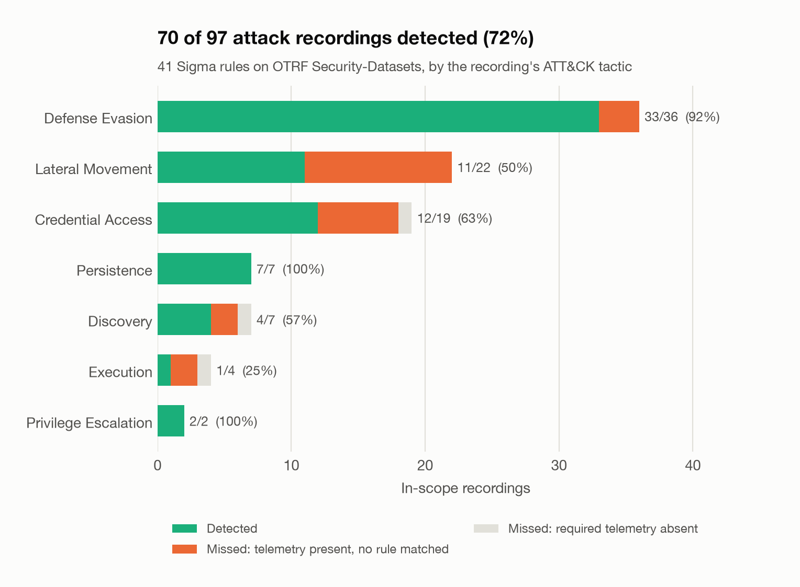
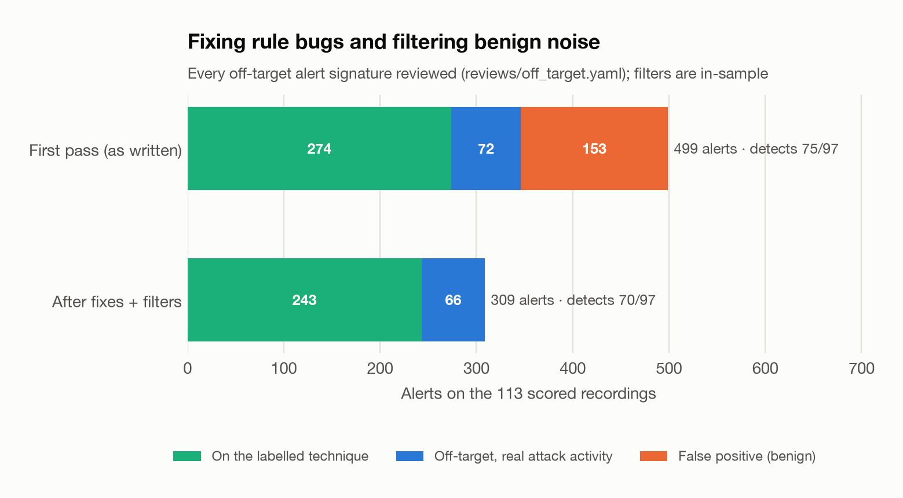
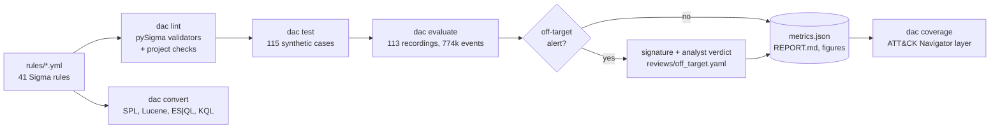
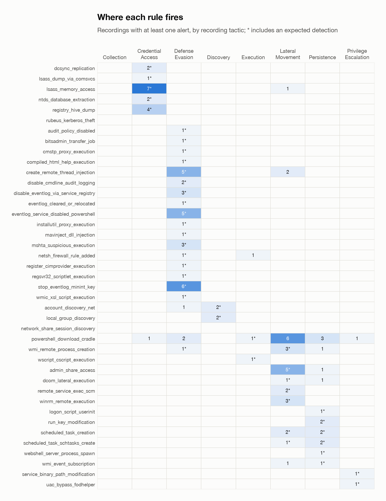

# Detection-as-code: Sigma rules tested like software

[](https://github.com/hugo-kte/detection-as-code/actions/workflows/ci.yml)


A detection-engineering pipeline that treats Sigma rules like code. Every rule is **linted**
(pySigma validators plus project checks), **unit-tested** against synthetic events,
**regression-tested** against 113 public recordings of ATT&CK techniques (OTRF
Security-Datasets: 774,034 Windows events), **converted** to Splunk SPL, Elastic and Microsoft
KQL, and published with an **ATT&CK Navigator coverage layer**. The data are pre-recorded public
logs: nothing is simulated or executed here.

The point of the project is the feedback loop. The first evaluation of the 41 hand-written rules
found two bug classes that neither pySigma nor my own linter had caught, and that a code review
would most likely miss. Every off-target alert was then reviewed and false positives were
filtered, with the before/after numbers below.

## Results

| | First pass (rules as written) | After fixes and filters |
|---|---:|---:|
| Attack recordings detected by a rule of their technique | 75 / 97 (77.3%) | **70 / 97 (72.2%)** |
| ... strict: no credit between sibling sub-techniques | 73 / 97 (75.3%) | 68 / 97 (70.1%) |
| In-scope recordings with an alert from any rule | 89 / 97 | 76 / 97 |
| Alerts on the 113 recordings | 499 | 309 |
| ... on the labelled technique | 274 | 243 |
| ... off-target but real attack activity (reviewed) | 72 | 66 |
| ... false positives (reviewed as benign) | **153 (30.7%)** | 0 (in-sample) |
| Off-target alert signatures reviewed | 51 (29 benign, 22 attack) | 21 (all attack) |

*Detected*: a rule sharing an ATT&CK technique or its parent with the recording's label fired on
it, so a T1003.002 rule firing on a T1003.001 recording counts. *Strict*: the same without that
credit between two different sub-techniques of one parent; it removes the same two recordings in
both passes (a SAM-dump recording caught only by the LSASS-access rule, a DCOM recording caught
only by the admin-share rule).

Numbers come from [`reports/metrics.json`](reports/metrics.json) and
[`reports/first_pass/metrics.json`](reports/first_pass/metrics.json); the full breakdown (every
miss, every signature with its verdict, every rule) is in [`reports/REPORT.md`](reports/REPORT.md).





**What this shows**

1. **Rule bugs are invisible until rules meet data.** Four rules repeated a key such as
   `CommandLine|contains` inside one selection. That is valid YAML, so PyYAML silently kept the
   last key, the first condition vanished, and pySigma parsed the rule without complaint: the
   SAM-hive rule fired on `reg.exe` command lines that merely touched a key under `HKLM\SYSTEM`.
   A fifth rule matched `ShareName|contains: 'C$'`, which is also true of `IPC$`, the named-pipe
   share every RPC client uses: 45 alerts. `dac lint` now rejects duplicate keys, and each bug
   has a regression test. Data does not catch everything either: a later code review found that
   the CMSTP rule's value list `['/s', '.inf']` meant OR where its description says AND (its unit
   test had been written to the code). It changed no result here and is logged as a bug fix.
2. **The first-pass detection rate was inflated.** Five of its 75 detections (remote service
   control over SMB) came only from the `IPC$` bug: right technique, wrong reason. After the fix
   they are honest misses, which is why the rate *drops* from 77.3% to 72.2% while precision
   improves.
3. **A third of first-pass alerts were noise.** The 153 false positives were Windows and OneDrive
   maintaining their scheduled tasks (70), `IPC$` (45), the Azure guest agent, boot-time handles
   and WMI queries opening LSASS (13), a monitoring agent's scripts (9), interactive shells (6),
   Windows network diagnostics running a script and `reg.exe` (4), domain-controller replication
   (3) and Defender or Teams registering autostart entries (3). Apart from the two bugs, each
   source was filtered narrowly (writer path **and** value name, computer account **and** built-in
   task path, task name **and** the program it runs, ...). The 0 after tuning is in-sample: the
   filters were written from these recordings, so it is not a false-positive rate for any other
   environment.
4. **Off-target is not the same as false.** 66 alerts fire on recordings labelled with another
   technique but are real attack activity. Empire's stager is a PowerShell download cradle,
   visible in the 14 Empire recordings whose script-block logs captured it; a DLL-hijack scenario
   stages its payload over `C$`; a "WMI execution" recording actually creates a WMI event
   subscription. Counting them as false positives would punish correct rules for the coarseness
   of dataset-level labels.
5. **Misses are explained, not hidden.** Of the 27 misses, 3 recordings lack the event types the
   expected rules read (no process-creation or script-block events), and 24 have them but use a
   mechanism no rule covers, for example API-based credential theft (Mimikatz over LSARPC/SAMR,
   Rubeus), DCOM through Office without a child process, or remote service control seen only as
   RPC on the `svcctl` pipe.

## How it works



* **Engine** ([`engine.py`](src/dac/engine.py)). pySigma parses each rule into a condition tree
  with value modifiers already applied; the engine compiles that tree once into a Python predicate
  and runs it on the flat JSON events. It supports the Sigma features the rules use and a few
  more: wildcards, `contains` / `startswith` / `endswith`, `all`, `cased`, `re` (with `i`, `m`,
  `s`), `windash`, the `base64` family, `cidr`, numeric comparisons, `exists`, `fieldref`, null
  values, keyword searches, `1 of` / `all of`, `not` and condition lists. Each feature has a test.
* **Log sources** ([`logsource.py`](src/dac/logsource.py)). Generic categories map to concrete
  `(channel, event id)` pairs (`process_creation` is Sysmon 1 or Security 4688,
  `registry_set` is Sysmon 13, `ps_script` is PowerShell 4104...); `service` log sources map to a
  channel and the rule selects the `EventID`. Field names follow the Sigma Windows taxonomy, with
  aliases so that a rule written for Sysmon also runs on native 4688 auditing.
* **Lint** ([`lint.py`](src/dac/lint.py)). The offline pySigma validators (the two that download
  ATT&CK and D3FEND data at runtime are skipped) plus: a strict YAML loader that rejects
  duplicate keys; unique ids, titles and file names; full metadata (`author`, `date`,
  `falsepositives`, `level`...); references only on attack.mitre.org; ATT&CK technique tags that
  exist in a vendored ATT&CK table ([`attack.py`](src/dac/attack.py)) plus a tactic tag that
  belongs to the technique; the file in the folder of its tactic; a log source the engine can run.
* **Alert signatures** ([`signatures.py`](src/dac/signatures.py)). Off-target alerts are grouped
  by rule and a few normalised fields: image names, registry keys with SIDs and GUIDs masked,
  account *type*, the first command-line argument. Command lines and script text are never part
  of a signature, so one reviewed verdict covers every alert of the same kind.

### A rule's path through the pipeline

Take [`registry_hive_dump`](rules/credential_access/registry_hive_dump.yml) (T1003.002/.004):

1. **Lint.** In the first pass it had two `CommandLine|contains` keys in one selection. Today
   `dac lint` stops it: `duplicate key 'CommandLine|contains' (line 27): a selection was dropped`.
2. **Unit test.** [`tests/rule_cases/registry_hive_dump.yml`](tests/rule_cases/registry_hive_dump.yml)
   holds 7 synthetic events: saves of the SAM, SECURITY and SYSTEM hives must match; a
   `reg add` under `HKLM\SYSTEM` (the duplicate-key regression) and an export of a SYSTEM
   *subkey* must not. Run against the first-pass rule, 2 of them fail.
3. **Regression test.** `dac evaluate` runs it on all recordings: it detects 3 of the 6
   recordings labelled with its techniques and raises 2 off-target alerts, both reviewed as attack
   activity (the boot-key extraction inside an unlabelled NTDS-dump recording).
4. **Review.** Its first-pass signatures (`reg.exe add`, `export`, `query`) are in
   [`reviews/off_target.yaml`](reviews/off_target.yaml) with verdicts; the fix is logged in
   [`reviews/tuning_log.yaml`](reviews/tuning_log.yaml) and visible in
   [`reports/first_pass/rules.diff`](reports/first_pass/rules.diff).
5. **Convert and publish.** `dac convert` emits SPL, Lucene, ES|QL and KQL for it, and
   `dac coverage` marks T1003.002 as validated in the Navigator layer.

### Query conversion

`dac convert` uses the pySigma backends (Splunk `splunk_windows`, Elastic `ecs_windows`, Kusto
with the Defender XDR tables first and the Azure Monitor / Sentinel `SecurityEvent` tables as a
fallback). A rule no pipeline can map is recorded with the backend's reason instead of failing the
run. Coverage: **SPL 41/41, Lucene 41/41, ES|QL 41/41, KQL 33/41**; the 8 KQL gaps use telemetry
the stock Microsoft pipelines have no table for (Sysmon process access and remote threads,
PowerShell script blocks, WMI events, System 7045, scheduled-task audit events). CI publishes the
queries as an artifact. Example, the event-log service being disabled:

```text
Splunk   TargetObject="*\\Services\\EventLog\\Start" Details="DWORD (0x00000004)"
Lucene   registry.path:*\\Services\\EventLog\\Start AND winlog.event_data.Details:"DWORD \(0x00000004\)"
KQL      DeviceRegistryEvents
         | where RegistryKey endswith "\\Services\\EventLog\\Start" and RegistryValueData =~ "DWORD (0x00000004)"
```

The KQL line also shows the limit of syntactic conversion: Defender stores the value as `4`, not
in Sysmon's `DWORD (0x00000004)` format, so a converted rule still needs testing on the target
platform.

## Evaluation protocol

* **Data.** 114 Windows host recordings from [OTRF Security-Datasets](https://github.com/OTRF/Security-Datasets),
  pinned at commit `d9d40ef`, each checked against its git SHA-1. One recording is shipped twice
  under two tactics with byte-identical events and is scored once (113). 7 carry no usable ATT&CK
  label (6 are referenced by no metadata file, one of them because its metadata links a file name
  absent at that commit; 1 maps only to the `T0000` placeholder); they are scanned and their
  alerts reviewed, but they never count as detections.
* **Expected detections.** A recording is in scope when at least one rule shares an ATT&CK
  technique with its label, sub-techniques counting under their parent (a T1003.002 rule firing
  on a T1003.001 recording counts; the *strict* count drops that credit between siblings). 97 of
  the 106 labelled recordings are in scope.
* **Detected** means at least one of those rules fired on at least one event of the recording.
  A miss is explained as *telemetry absent* (none of the expected rules' event types is in the
  recording) or *no rule matched*.
* **Alerts** are matching events. A process start logged both by Sysmon (event 1) and by Security
  auditing (4688) counts as two alerts, as it would in a SIEM that ingests both.
* **Off-target alerts** (a rule firing on a recording not labelled with its technique) are
  grouped into signatures and each signature gets a verdict, `benign` or `attack`, with a one-line
  rationale. `dac evaluate` flags any unreviewed signature.
* **Tuning rules.** Only bug fixes and filters for activity reviewed as benign were allowed; no
  rule was added or widened after the first evaluation. The first pass can be rebuilt and
  re-scored with `make first-pass`.

## Limitations

* **Dataset-level labels.** A label names the technique a recording was made for, not every
  technique it contains. Multi-step scenarios make "off-target" alerts that are true attack
  activity; the review separates them, but it is my judgement, recorded and open to challenge.
* **Lab recordings, little benign background.** Each recording covers minutes on a few lab hosts.
  The first-pass false-positive count shows the kind of noise these rules raise; it is not an
  estimate of alert volume on a production network, and the post-tuning zero is in-sample.
* **One recording per technique, often.** Most techniques have one or two recordings, all
  produced with a handful of frameworks (Empire, Covenant, Metasploit, Atomic tests). A rule that
  detects them can still miss another implementation.
* **Tuned and scored on the same data.** The filters came from reviewing these recordings, so the
  after-tuning numbers are optimistic; the first pass is the unbiased one.
* **Engine, not a SIEM.** The matcher implements Sigma semantics over flat JSON. Converted
  queries are syntactically valid backend output but were not run on Splunk, Elastic or Sentinel.
* **Coverage is partial.** 10 techniques exercised by the recordings have no rule (for example
  T1550.002, T1574.001, T1123), and 3 rules have no validated detection on their own technique
  (`rubeus_kerberos_theft`, `network_share_session_discovery`, `powershell_download_cradle`, the
  last of which does fire in 14 Empire scenarios labelled with other techniques).

## Rule catalogue

| Tactic | Rule | ATT&CK | Telemetry | Own-technique recordings detected |
|---|---|---|---|---:|
| Credential access | [Active Directory Replication From Non-DC (DCSync)](rules/credential_access/dcsync_replication.yml) | T1003.006 | Security 4662 | 2 / 2 |
| Credential access | [LSASS Memory Dump via comsvcs.dll MiniDump](rules/credential_access/lsass_dump_via_comsvcs.yml) | T1003.001 | Sysmon 1 / Security 4688 | 1 / 5 |
| Credential access | [LSASS Process Memory Accessed With Dump-Capable Rights](rules/credential_access/lsass_memory_access.yml) | T1003.001 | Sysmon 10 | 5 / 5 |
| Credential access | [Active Directory NTDS.dit Database Extraction](rules/credential_access/ntds_database_extraction.yml) | T1003.003 | Sysmon 1 / Security 4688 | 1 / 4 |
| Credential access | [SAM/SECURITY/SYSTEM Registry Hive Dump](rules/credential_access/registry_hive_dump.yml) | T1003.002, T1003.004 | Sysmon 1 / Security 4688 | 3 / 6 |
| Credential access | [Kerberos Ticket Theft Tooling in PowerShell](rules/credential_access/rubeus_kerberos_theft.yml) | T1558.003 | PowerShell 4104 | 0 / 1 |
| Defense evasion | [Audit Policy Disabled via auditpol](rules/defense_evasion/audit_policy_disabled.yml) | T1562.002 | Sysmon 1 / Security 4688 | 1 / 17 |
| Defense evasion | [File Download via BITS Job](rules/defense_evasion/bitsadmin_transfer_job.yml) | T1197 | Sysmon 1 / Security 4688 | 1 / 1 |
| Defense evasion | [CMSTP Silent INF Proxy Execution](rules/defense_evasion/cmstp_proxy_execution.yml) | T1218.003 | Sysmon 1 / Security 4688 | 1 / 1 |
| Defense evasion | [Compiled HTML Help Executing a CHM Payload](rules/defense_evasion/compiled_html_help_execution.yml) | T1218.001 | Sysmon 1 / Security 4688 | 1 / 1 |
| Defense evasion | [Remote Thread Created in Another Process](rules/defense_evasion/create_remote_thread_injection.yml) | T1055 | Sysmon 8 | 4 / 6 |
| Defense evasion | [Process Command-Line Audit Logging Disabled](rules/defense_evasion/disable_cmdline_audit_logging.yml) | T1562.002 | Sysmon 13 | 2 / 17 |
| Defense evasion | [Event Log Service Disabled via Start-Type Registry](rules/defense_evasion/disable_eventlog_via_service_registry.yml) | T1562.002 | Sysmon 13 | 3 / 17 |
| Defense evasion | [Security Event Log Cleared or Relocated via wevtutil](rules/defense_evasion/eventlog_cleared_or_relocated.yml) | T1070.001, T1562.002 | Sysmon 1 / Security 4688 | 1 / 17 |
| Defense evasion | [Logging Service Disabled via PowerShell Service Cmdlet](rules/defense_evasion/eventlog_service_disabled_powershell.yml) | T1562.002 | PowerShell 4104 | 5 / 17 |
| Defense evasion | [InstallUtil Uninstall Proxy Execution](rules/defense_evasion/installutil_proxy_execution.yml) | T1218.004 | Sysmon 1 / Security 4688 | 1 / 1 |
| Defense evasion | [Mavinject Running-Process DLL Injection](rules/defense_evasion/mavinject_dll_injection.yml) | T1055 | Sysmon 1 / Security 4688 | 1 / 6 |
| Defense evasion | [Mshta Executing Script or Remote Content](rules/defense_evasion/mshta_suspicious_execution.yml) | T1218.005 | Sysmon 1 / Security 4688 | 3 / 3 |
| Defense evasion | [Windows Firewall Rule Added via Netsh](rules/defense_evasion/netsh_firewall_rule_added.yml) | T1562.004 | Sysmon 1 / Security 4688 | 1 / 1 |
| Defense evasion | [DLL Executed via Register-CimProvider](rules/defense_evasion/register_cimprovider_execution.yml) | T1218 | Sysmon 1 / Security 4688 | 1 / 10 |
| Defense evasion | [Regsvr32 Scriptlet or Remote COM Registration](rules/defense_evasion/regsvr32_scriptlet_execution.yml) | T1218.010 | Sysmon 1 / Security 4688 | 1 / 1 |
| Defense evasion | [Event Logging Disabled via MiniNt Registry Key](rules/defense_evasion/stop_eventlog_minint_key.yml) | T1562.002 | Sysmon 12-14 | 6 / 17 |
| Defense evasion | [WMIC Executing a Remote or Local XSL Script](rules/defense_evasion/wmic_xsl_script_execution.yml) | T1220 | Sysmon 1 / Security 4688 | 1 / 1 |
| Persistence | [Logon Script Registered via UserInitMprLogonScript](rules/persistence/logon_script_userinit.yml) | T1037.001 | Sysmon 13 | 1 / 1 |
| Persistence | [Autorun Registry Run Key Set](rules/persistence/run_key_modification.yml) | T1547.001 | Sysmon 13 | 2 / 2 |
| Persistence | [Scheduled Task Created or Updated](rules/persistence/scheduled_task_creation.yml) | T1053.005 | Security 4698/4702 | 4 / 4 |
| Persistence | [Scheduled Task Created via schtasks](rules/persistence/scheduled_task_schtasks_create.yml) | T1053.005 | Sysmon 1 / Security 4688 | 3 / 4 |
| Persistence | [Web Server Process Spawning a Command Shell](rules/persistence/webshell_server_process_spawn.yml) | T1505.003 | Sysmon 1 / Security 4688 | 1 / 1 |
| Persistence | [WMI Permanent Event Subscription Created](rules/persistence/wmi_event_subscription.yml) | T1546.003 | Sysmon 19-21 | 1 / 1 |
| Privilege escalation | [Existing Service Binary Path Modified via sc](rules/privilege_escalation/service_binary_path_modification.yml) | T1543.003 | Sysmon 1 / Security 4688 | 1 / 1 |
| Privilege escalation | [UAC Bypass via ms-settings Shell Open Command](rules/privilege_escalation/uac_bypass_fodhelper.yml) | T1548.002 | Sysmon 12-14 | 1 / 1 |
| Lateral movement | [Access to a Hidden Administrative Share](rules/lateral_movement/admin_share_access.yml) | T1021.002 | Security 5145 | 1 / 7 |
| Lateral movement | [Command Shell Spawned by a DCOM Server](rules/lateral_movement/dcom_lateral_execution.yml) | T1021.003 | Sysmon 1 / Security 4688 | 1 / 4 |
| Lateral movement | [Service Installed to Run a Command Interpreter](rules/lateral_movement/remote_service_exec_scm.yml) | T1021.002 | System 7045 | 1 / 7 |
| Lateral movement | [Process Launched by WinRM Host Process](rules/lateral_movement/winrm_remote_execution.yml) | T1021.006 | Sysmon 1 / Security 4688 | 2 / 3 |
| Discovery | [Account Discovery via net user](rules/discovery/account_discovery_net.yml) | T1087.001, T1087.002 | Sysmon 1 / Security 4688 | 2 / 2 |
| Discovery | [Local or Domain Group Membership Discovery via net](rules/discovery/local_group_discovery.yml) | T1069.001, T1069.002 | Sysmon 1 / Security 4688 | 2 / 4 |
| Discovery | [Network Share and Session Discovery via net](rules/discovery/network_share_session_discovery.yml) | T1049, T1135 | Sysmon 1 / Security 4688 | 0 / 2 |
| Execution | [PowerShell Download Cradle in Script Block](rules/execution/powershell_download_cradle.yml) | T1059.001 | PowerShell 4104 | 0 / 1 |
| Execution | [Process Launched by WMI Provider Host](rules/execution/wmi_remote_process_creation.yml) | T1047 | Sysmon 1 / Security 4688 | 3 / 6 |
| Execution | [Script Host Executing a Script File](rules/execution/wscript_cscript_execution.yml) | T1059.005 | Sysmon 1 / Security 4688 | 1 / 1 |

The last column counts in-scope recordings labelled with one of the rule's own techniques. Several rules share a technique (17 recordings exercise T1562.002, covered by 6 rules that each target one mechanism), so a low ratio on one rule is not a miss of the technique.



The ATT&CK Navigator layer is [`reports/attack_navigator_layer.json`](reports/attack_navigator_layer.json)
(load it in the [Navigator](https://mitre-attack.github.io/attack-navigator/)): 36 techniques with a
validated rule, 8 with a rule not validated on this data, 10 exercised by recordings but not
covered.

## Quickstart

```bash
git clone https://github.com/hugo-kte/detection-as-code.git && cd detection-as-code
make install
make rules-lint            # pySigma validators + project checks
make test                  # 197 tests, no dataset needed
make convert               # SPL / Lucene / ES|QL / KQL -> reports/queries/
make download              # 214 pinned files (~61 MB) from OTRF Security-Datasets, SHA-1 verified
make evaluate              # detection matrix, metrics, report, figures -> reports/
make coverage              # ATT&CK Navigator layer
make first-pass            # rebuild and re-score the rules as first written
```

```text
dac lint [--rules DIR]
dac test [--rules DIR] [--cases DIR]
dac evaluate [--data DIR] [--rules DIR] [--reviews FILE] [--out DIR] [--jobs N]
dac convert [-o DIR] [--target splunk|lucene|esql|kql ...]
dac coverage [--metrics reports/metrics.json] [-o FILE]
dac download [-o DIR]
```

Adding a rule: write `rules/<tactic>/<name>.yml`, add `tests/rule_cases/<name>.yml` with at
least one matching and one non-matching event, then `make rules-lint test evaluate` and give a
verdict to any new off-target signature in `reviews/off_target.yaml`.

## Project structure

```text
rules/<tactic>/*.yml         41 Sigma rules
tests/rule_cases/*.yml       115 synthetic must-match / must-not-match events, one file per rule
reviews/off_target.yaml      analyst verdict for every off-target alert signature
reviews/tuning_log.yaml      every change made after the first evaluation, and why
src/dac/
├── engine.py                compiles pySigma condition trees into event predicates
├── logsource.py             Sigma log source -> (channel, event id), field aliases
├── lint.py                  pySigma validators + project checks (strict YAML, ATT&CK tags...)
├── ruletest.py              runner for tests/rule_cases
├── datasets.py              pinned manifest, verified download, catalogue, loader
├── evaluate.py              parallel scan, expected detections, misses, off-target, metrics
├── signatures.py, review.py alert signatures and analyst verdicts
├── convert.py               pySigma backends with fallbacks and graceful failures
├── coverage.py              ATT&CK Navigator layer
├── attack.py                vendored slice of ATT&CK (techniques, tactics)
└── report.py, plots.py, cli.py
configs/security_datasets.json   pinned file list with git SHA-1s
reports/                     metrics.json, REPORT.md, detection_matrix.csv, figures/,
                             attack_navigator_layer.json, first_pass/ (metrics, report, rules.diff)
```

## Data, license and credits

Recordings: [OTRF Security-Datasets](https://github.com/OTRF/Security-Datasets) (formerly Mordor),
MIT License, by Roberto Rodriguez ([@Cyb3rWard0g](https://github.com/Cyb3rWard0g)), Jose Rodriguez
([@Cyb3rPandaH](https://github.com/Cyb3rPandaH)) and contributors, pinned at commit
`d9d40ef123d2c87d5d3df28c96bcab4f0faccc87`. The data are downloaded by `make download` and never
committed; only the labels' technique IDs are used, and the scenario descriptions in the upstream
metadata are not copied here. Technique names and IDs are from [MITRE ATT&CK®](https://attack.mitre.org/).
Rules and test events in this repository describe what to detect, not how to perform an attack.

Code and rules: [MIT](LICENSE).

```bibtex
@misc{otrf_security_datasets,
  author = {Rodriguez, Roberto and Rodriguez, Jose},
  title  = {Security Datasets},
  year   = {2019},
  howpublished = {\url{https://github.com/OTRF/Security-Datasets}},
  note   = {Open Threat Research Forge, commit d9d40ef}
}
```
